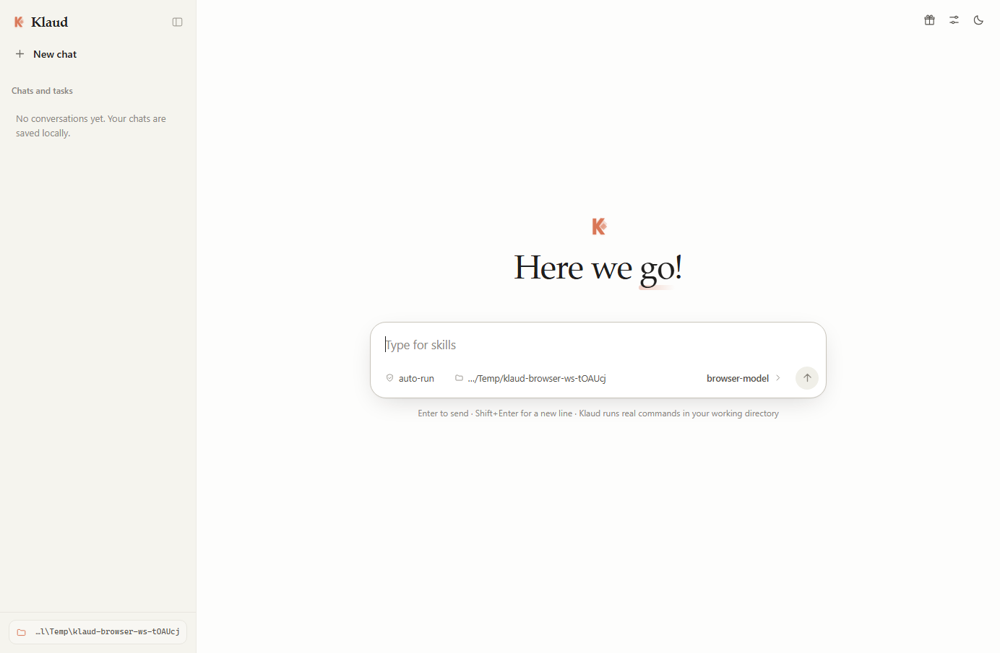
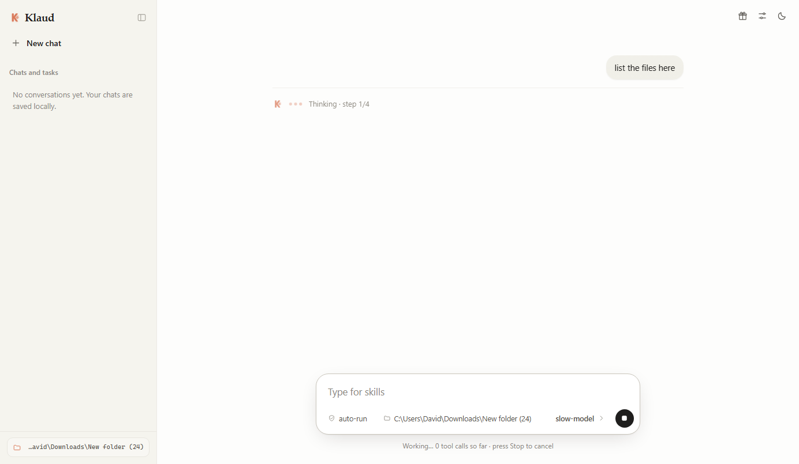

# Klaud

**v1.0.1** — a local coding agent with a built-in list of **genuinely free, no-card
OpenAI-compatible providers**. It reads and writes real files on your machine,
runs real commands, and verifies its own work — behind a warm, paper-like
interface.

Bring your own key, or bring no key at all. Nothing else to install: no npm
packages, no build step, no database. Node 18+ and the standard library.





```
  ◆ Klaud  local coding agent
  ────────────────────────────────────────────────
  url        http://127.0.0.1:4317
  workspace  C:\Users\you\projects\my-app
  model      agnes-3.0-flash:free
```

## Quick start

**Windows** — double-click `start-klaud.cmd`
**macOS / Linux** — `./start-klaud.sh`
**Any platform** — `npm start`, then open the URL it prints

The console prints a URL carrying a session token. Open it once and Klaud
remembers the browser. Every `/api/*` route requires that token, so a random web
page on your machine cannot drive your agent.

## Start free — no card, ever

The **Free** button in the top bar opens a picker of endpoints that cost nothing.
Every base URL was probed and confirmed live, and the OpenRouter entry reads its
model list in real time.

**Read this before trusting a number.** Rate-limit figures are *not* verified by
Klaud. The big providers have stopped publishing fixed free-tier numbers
altogether — Google's docs now say limits depend on your usage tier and are
applied per project, and Groq's own rate-limit page calls its table "a high level
summary" and tells you to read the exact numbers from your account settings. So
each card is labelled with where its figure came from, links to the provider's
own page, and says "not published" where there is no public number to quote.

| Provider | Basis | Free tier |
| --- | --- | --- |
| **NVIDIA NIM** ⭐ | not published | **The recommended pick.** ~40 requests/minute on `nvidia/nemotron-3.5-super-vl-120b-a12b` — a model built for tool use. A rate limit refills every minute, unlike a daily quota. No card. See the caveats below. |
| **Ollama / LM Studio** | no quota | Nothing is metered. The only allowance that never runs out. |
| **Groq** | published | Free plan: 30 requests/min, 1,000/day, 8k tokens/min for `openai/gpt-oss-120b`. A full per-model table, shown in the model picker. |
| **Mistral La Plateforme** | not published | Measured in tokens, not requests: roughly 1B tokens/month and 500k tokens/min per model. Needs a phone-verified account. |
| **Google AI Studio** | not published | Google no longer publishes figures. The free tier covers Flash-class models only — Pro is excluded. |
| **Cloudflare Workers AI** | published | 10,000 Neurons/day with per-model rates published, so you can compute exactly what a model costs. **One-field setup** — see below. |
| **OpenRouter** | not published | ~50 free requests/day, ~1,000/day after a one-time $10 credit. Best model variety. |

Removed on purpose, and recorded in the app with dates and source links:

- **GitHub Models** — [retired 30 July 2026](https://github.blog/changelog/2026-07-30-github-models-is-now-retired/). Its old hostname still answers `200 OK` to every path, which is why a naive liveness check kept it listed.
- **Cerebras** — no free tier any more; a one-time $5 promotional credit that [requires a payment method](https://www.cerebras.ai/pricing) and expires in 30 days.
- **Together AI**, **SambaNova** — free tier ended and 20 requests/day respectively.

Trial-credit offers are excluded throughout.

### Two caveats on the recommended pick

NVIDIA's trial terms allow **testing, prototyping and evaluation — not production
use**, and they let NVIDIA collect de-identified prompts and outputs to improve
its models. Klaud reads your files, so that content travels to NVIDIA. Fine for
open-source work; think twice for private code. Both are on the card in the app,
not buried here.

> **Tool calling is not optional.** Reading files, editing them and running
> commands all need it. If a model refuses the tool schema, Klaud says so in the
> transcript and continues as plain chat instead of failing silently.
>
> **Rate limits are the usual reason an agent turn stalls.** An agent needs 5–15
> requests per task. Local models have no limit at all and are the only option
> that never runs out; Groq and Cloudflare are the best hosted bets.

### The recommended free setup: NVIDIA NIM

**Free → NVIDIA NIM → Set up automatically.** One free key from
[build.nvidia.com](https://build.nvidia.com/nvidia/nemotron-3.5-super-vl-120b-a12b), no card,
and the model it points at is `nvidia/nemotron-3.5-super-vl-120b-a12b` — a 120B
mixture-of-experts that activates 12B parameters per token and was built for
agentic work: reasoning, instruction following and **tool use** in one model.
NVIDIA reports it beating its own Nemotron 3 Ultra on Hermes Bench (63.4% vs
56.3%) and LangChain evals (87.1% vs 84.3%).

Why it is the default rather than Cloudflare:

| | NVIDIA NIM | Cloudflare Workers AI |
| --- | --- | --- |
| Limit kind | ~40 requests/minute | 10,000 Neurons/day |
| Runs out? | resets every minute | yes, once the day's Neurons are spent |
| Card needed | no | no |
| Account ID dance | none — just a key | needs your account ID in the URL |

The important difference is the **kind** of limit. A per-minute rate limit refills
continuously, so an agent that makes 15 requests in a turn is throttled for a
minute rather than dead until midnight. A per-day quota is spent.

Two caveats are on the card itself, because they matter for a coding agent:

- **Trial terms allow testing, prototyping and evaluation — not production use.**
- **NVIDIA may collect de-identified prompts and outputs to improve its models.**
  Klaud reads your files, so that content travels to NVIDIA. Fine for open-source
  work; think twice for private code.

Confirm the model is still served at any time — this needs no key, which is what
makes the claim checkable:

```
npm run check-nvidia
```

Pass a key to also run a live tool-calling round trip. If NVIDIA drops the model,
this says so instead of letting the recommendation go stale.

### Cloudflare: the account ID is handled for you

Cloudflare is the best-value free tier here, but its URL normally needs your
account ID — a 32-character hex string. Klaud tries to save you the trip:

1. **The account ID is read out of your token.** A Cloudflare API token is a JWT
   whose claims carry the account it was scoped to, so this usually needs no
   network call. It prefers explicit claims and only falls back to a whole-payload
   scan when a single unambiguous candidate exists.
2. **The account ID field is always visible**, and optional. If you already have
   it, paste it — that skips discovery entirely, which matters because
   account-scoped tokens cannot be discovered.
3. **A real completion is sent before anything is saved.** Nothing is written
   unless a model answers.
4. Failures name their stage and show Cloudflare's own words.

If it still refuses, `npm run check-cloudflare` tells you which of the two values
is wrong.

### Any other endpoint

Anything speaking `POST {baseUrl}/chat/completions` with SSE and tool calls
works. Klaud's Settings presets lead with the free options, then the locals, then
the paid ones:

| Provider | Base URL |
| --- | --- |
| NVIDIA NIM · free | `https://integrate.api.nvidia.com/v1` |
| Groq · free | `https://api.groq.com/openai/v1` |
| Google AI Studio · free | `https://generativelanguage.googleapis.com/v1beta/openai` |
| OpenRouter | `https://openrouter.ai/api/v1` |
| Ollama · local | `http://localhost:11434/v1` |
| LM Studio · local | `http://localhost:1234/v1` |
| OpenAI | `https://api.openai.com/v1` |
| Mistral | `https://api.mistral.ai/v1` |
| DeepSeek | `https://api.deepseek.com/v1` |
| xAI | `https://api.x.ai/v1` |
| Cloudflare Workers AI | `https://api.cloudflare.com/client/v4/accounts/ACCOUNT_ID/ai/v1` |

**Test connection** verifies the key and URL line up. **Load models** queries
`{baseUrl}/models` and gives you a picker — over POST for Cloudflare, which
answers `405` to a GET, and over GET everywhere else.

Keys are stored on your machine only, in `~/.klaud/settings.json`, and are never
returned to the browser — the UI only ever sees a masked hint like
`sk-pro…••••••••4d9c`.

## What it can do

Nine tools, all confined to the working directory you choose:

| Tool | What it does |
| --- | --- |
| `read_file` | Reads UTF-8 text with line numbers, paged with `offset` / `limit` |
| `write_file` | Creates a file (and parent directories); refuses to clobber unless `overwrite: true` |
| `edit_file` | Exact-string replacement; rejects ambiguous matches and tells the model why |
| `list_dir` | Lists a directory, flat or recursive |
| `glob_files` | Finds files by pattern, e.g. `src/**/*.{js,tsx}` |
| `search_text` | Regex content search with `file:line` results |
| `run_command` | Runs a shell command, returns stdout, stderr and the real exit code |
| `fetch_url` | Reads a web page or API over the network, HTML stripped to text |
| `todo_write` | Keeps a visible task list for multi-step jobs |

The model sees each result, so it can run a build, read the error, fix the file,
and run it again — up to the step limit you configure.

### How the loop avoids getting stuck

A model that keeps asking for the same thing is the classic failure of a tool
loop, and it is worst on the free tiers this app targets. Klaud guards against it
in the loop itself rather than trusting the model to notice:
- **Identical calls are refused.** A repeat of a call already made this turn is
  answered with the earlier result and a warning; a second repeat is blocked
  outright. Calls with *different* arguments are untouched — that is real work.
  Argument comparison ignores key order, so `{"a":1,"b":2}` and `{"b":2,"a":1}`
  count as the same call.
- **A repeated step ends the turn.** If a whole step repeats, the loop stops and
  the model is asked for a final answer with tools withheld. The alternative is
  burning every remaining step and a chunk of your rate limit for nothing.
- **Failures carry a next action.** A tool error is appended with a concrete
  alternative — read the file first, check the path with `glob_files`, use the
  native shell equivalent. A bare "not found" gives the model nothing to change,
  which is exactly why it retries.
- **The step limit is announced.** Two steps before the cap the model is told to
  stop starting things and write a summary, so a long job ends with a hand-off
  rather than mid-sentence.
- **A silent finish is challenged once.** Some models complete the work and then
  end the turn without writing anything, leaving an empty reply. Klaud asks once,
  explicitly, for prose. If the model stays silent it says so rather than showing
  a blank transcript.
- **Throttling is respected, not hammered.** `Retry-After` and waits quoted in
  the provider's message ("retry in 42s") are honoured. A fixed 1.5s backoff
  against a per-minute free tier just burns every attempt and reports a failure
  that would have cleared on its own. A wait longer than a minute fails fast with
  the reason instead of appearing to hang.

- **A wait never looks like a hang.** Between sending and the first token the
  transcript used to be blank, which on a slow free tier is the longest part of
  the turn. There is now a working indicator — a breathing mark, three dots
  pulsing in sequence, and a sheen across the label — that names the phase
  ("Thinking · step 2/4", "Running run_command", "Reasoning") and appears again
  after each tool result, while the model reads it. It is disabled under
  `prefers-reduced-motion`, which leaves a static row rather than a blank one.

### Permissions

Three modes, switchable from the top bar:

- **Auto-run** — no prompts. Fastest, and the default.
- **Ask first** — every write and every command waits for your approval, shown
  inline in the transcript with the exact arguments.
- **Read-only** — all writes and command execution are refused, by the server,
  not just hidden in the UI.

### The working directory and folder picker

Click the folder in the sidebar to change where Klaud works. Type a full path and
press Enter to jump anywhere, click a folder to descend into it, or use **New
folder** to create one where you are. The **Use "name"** button always names the
folder it will select, so there is no guessing which one you are about to switch
to.

## Safety model

Klaud runs a model's instructions against your filesystem, so the boundaries are
enforced in code, not in the prompt:

- **Path confinement.** Every path goes through `resolveInside(root, input)`,
  which resolves and then rejects anything outside the workspace — `../`,
  absolute paths and null bytes included. The check is on the resolved path.
- **Loopback only.** The server binds `127.0.0.1` and requires the session token
  on every API route.
- **A way back in.** If the browser holds a stale token, every request would
  401 — including the settings call. Instead Klaud shows a screen with a
  **Re-authorize this browser** button: it asks the server to open a fresh tab
  with a valid session, which only ever acts on the machine it runs on. Pasting
  the token from `~/.klaud/session.json` remains as a fallback, and the server
  reprints its working URL in the terminal whenever it rejects a request.
- **Destructive commands are refused.** Patterns like `rm -rf /`, `mkfs`,
  `diskpart`, `format C:` and fork bombs are blocked before spawning.
- **Real exit codes.** Windows shells report a child's non-zero exit as `1` and
  a failed cmdlet as `0`; Klaud wraps commands so the model sees the truth —
  otherwise it "fixes" builds that were never broken.
- **Timeouts and truncation.** Commands are killed at the limit (60s default,
  120s max); tool output is capped so one huge file cannot eat the context.
- **Symlink policy.** Path confinement is lexical. A symlink inside the
  workspace that points outside it will be followed. Do not point the workspace
  at a directory whose symlinks you do not trust.

## Configuration

Change any of this in Settings, or edit `~/.klaud/settings.json` directly.

| Setting | Default | Notes |
| --- | --- | --- |
| Base URL | `https://api.openai.com/v1` | Anything OpenAI-compatible |
| API key | — | Stored locally, never sent to the browser |
| Model | `gpt-4o-mini` | Load the full list from the endpoint |
| Temperature | `0.2` | 0.1–0.3 is best for editing code |
| Reasoning effort | Provider default | A slider: Provider default / Low / Medium / High. See below. |
| Steps per turn | `12` | Tool round trips allowed in one request (max 40) |
| History budget | `80000` | Characters of transcript per request (~20k tokens). Older turns are dropped when a long session outgrows it, newest kept. |
| Working directory | The folder Klaud runs in | All tools are confined here |
| Tool permissions | Auto-run | See above |
| System prompt | A coding-agent prompt | Replace it for different behaviour |

Environment overrides: `PORT`, `KLAUD_HOST`, `KLAUD_WORKSPACE`,
`KLAUD_DATA_DIR`, `KLAUD_OPEN=1`.

### Reasoning effort, and why most providers get nothing

There is no standard field for this, so Klaud sends the one each host documents
and **sends nothing at all** to everyone else:

| Host | Field sent |
| --- | --- |
| `api.openai.com` | `reasoning_effort: "low" \| "medium" \| "high"` |
| `openrouter.ai` | `reasoning: { effort: … }` — OpenRouter's normalised form, which it translates for whichever model it routes to |
| `integrate.api.nvidia.com` | **nothing** — NVIDIA's NIM reference documents no effort parameter |
| Groq, Google AI Studio, Mistral, DeepSeek, xAI, Cloudflare, Ollama, LM Studio, anything unknown | **nothing** |

Silence is deliberate, not an oversight. A provider that does not recognise a
body parameter can reject the entire request with a `400`, so one wrong guess
kills the turn. "OpenAI-compatible" does not mean "tolerates unknown keys", and
the Settings panel says plainly which of the two is happening for your endpoint.

"Provider default" leaves the parameter off entirely, so nothing changes unless
you move the slider.

## Where your data lives

```
~/.klaud/
  settings.json      provider config and API key
  session.json       the local API token
  chats/*.json       one file per conversation
```

Klaud was previously called Forge. On first run it adopts an existing `~/.forge`
directory, so saved conversations and keys carry over instead of vanishing.

Delete the folder to reset everything. Nothing is sent anywhere except to the API
endpoint you configure.

## Architecture

A single Node process serves the UI and runs the agent loop; the browser holds
the transcript and renders the stream.

```
src/
  server.js        HTTP + SSE API, static files, token auth
  agent.js         the loop: model -> tool calls -> results -> model
  llm.js           OpenAI-compatible streaming client, tool-call assembly
  providers.js     the free-provider catalogue and live free-model lookup
  store.js         JSON persistence for chats and settings
  config.js        paths, limits, defaults, data-dir migration
  lib/
    tools.js       the nine tools, shell wrapper, diffing
    fsutil.js      path confinement, glob matching, tree walking
public/
  index.html       shell markup + SVG icon sprite
  styles.css       design tokens, light and dark themes, polish layer
  app.js           transcript rendering, SSE client, settings and pickers
  markdown.mjs     dependency-free markdown renderer
test/
  run.js                  62 unit and integration checks
  markdown.mjs            29 renderer and escaping checks
  ui-static.js            28 frontend integrity checks
  cloudflare-token.mjs    16 token claim extraction checks
  cloudflare-setup.js     27 setup-path checks against a stand-in API
  cloudflare-errors.js    40 Cloudflare error-reporting checks
  providers.js            53 free-provider catalogue checks
  e2e-http.js             37 checks against a live server
  auth-recovery.js        21 session token recovery checks
  folder-picker.js        30 folder browser and workspace checks
  browser.js              66 checks driving the app in headless Chrome
```

The agent loop lives on the server so a browser refresh cannot corrupt a turn,
and so tool calls execute next to the files they touch. Events stream to the
browser as they happen (`text`, `reasoning`, `tool_call`, `tool_result`,
`todos`, `approval_request`, `usage`), which is why you watch the work instead of
waiting for it.

### API

Everything under `/api/*` needs the `x-klaud-token` header.

| Method | Route | Purpose |
| --- | --- | --- |
| `GET` | `/api/health` | Liveness (public) |
| `POST` | `/api/authorize` | Open a fresh authorized tab (loopback callers only) |
| `GET` | `/api/info` | Platform, shell, tool catalogue |
| `GET` | `/api/providers/free` | The free-provider catalogue, with live free models |
| `POST` | `/api/providers/setup` | One-field setup (Cloudflare): resolves the account, tests, saves |
| `GET` `PATCH` | `/api/settings` | Read or update configuration |
| `POST` | `/api/models` | List models from the configured endpoint |
| `POST` | `/api/models/test` | Verify key + URL + model |
| `POST` | `/api/chat` | Run a turn; streams SSE |
| `POST` | `/api/chat/:turnId/cancel` | Stop a running turn |
| `POST` | `/api/chat/:turnId/approval` | Answer a permission request |
| `POST` | `/api/tool` | Execute one tool directly |
| `GET` `POST` `DELETE` | `/api/chats` | List, create, clear conversations |
| `GET` `PUT` `DELETE` | `/api/chats/:id` | Read, save or delete one |
| `GET` | `/api/fs` | Browse directories for the workspace picker |
| `POST` | `/api/fs/mkdir` | Create a folder from the workspace picker |

## Testing

```
npm test
```

611 checks in total, no test framework, no dependencies. Every suite is
self-contained: they spawn their own servers on throwaway data directories, so
running the tests can never disturb your real configuration.

| Suite | Checks | What it proves |
| --- | --- | --- |
| `test/run.js` | 108 | Tool sandbox, shell exit codes, LLM client, agent loop, **loop detection**, reasoning-effort wire format, retry timing, history pruning |
| `test/markdown.mjs` | 29 | Markdown rendering and HTML escaping |
| `test/ui-static.js` | 38 | Element ids, icon sprite, CSS coverage, module wiring, working-indicator animations |
| `test/cloudflare-token.mjs` | 16 | Account IDs are read from every token claim shape, and never guessed |
| `test/cloudflare-setup.js` | 42 | The setup path against a stand-in Cloudflare API, including empty account lists |
| `test/cloudflare-errors.js` | 51 | Every Cloudflare failure explains itself; a bare "unknown" is impossible |
| `test/providers.js` | 79 | Catalogue honesty, the NVIDIA recommendation, live lookups, no silent config changes |
| `test/e2e-http.js` | 37 | The full HTTP and SSE API, plus malformed-request resilience |
| `test/auth-recovery.js` | 21 | A stale session token can be recovered with one click |
| `test/folder-picker.js` | 30 | Typing a path, creating a folder, switching workspace |
| `test/browser.js` | 160 | The app driven in headless Chrome, start to finish, including that a mouse click paints no accent ring |

`test/browser.js` is the important one. It launches Chrome, loads the real page,
and fails on any uncaught exception or console error. It then types a message,
clicks send, waits for the reply to stream in, and checks that the file really
appeared on disk. A suite that only inspects markup cannot catch "the page loads
but nothing runs", which is exactly the class of bug that matters most here.

The browser suite writes screenshots to `docs/` so you can see what it saw.

## Troubleshooting

**Cloudflare fails and you want to know exactly why** — run the checker instead
of reading a UI:

```
npm run check-cloudflare
```

It uses the token already in your settings, prints Cloudflare's raw response for
every step, and says which of the two values is wrong. Pass your account ID to
test a different one:

```
npm run check-cloudflare -- 0264a5ba1b8e355492b8570976239fb3
```

**Copying a URL from documentation** — the `{account_id}` and similar bracketed
parts in this file are **placeholders, not part of the URL**. Pasted verbatim they
produce `URL rejected: Bad hostname` from curl, because Windows treats `<` and `>`
as redirections. Replace the bracketed part with your own 32-character account
ID, or let Klaud build the URL for you via **Free → Cloudflare → Set up
automatically**. Klaud now detects leftover brackets and says so instead of
sending a broken request.

**"This browser needs to be re-authorized"** — the tab holds a session token
from an earlier server run. Click **Re-authorize this browser**; a fresh tab with
a valid session opens and you are back in. If that fails, open the URL the server
prints (it reprints it in the terminal whenever it rejects a request), or paste
the `token` value from `~/.klaud/session.json` under "That didn't work".

**"No API key configured"** — click **Free** in the top bar, or open Settings.

**`HTTP 404` from the provider** — the base URL usually needs to end in `/v1`.

**`HTTP 401` from the provider** — that is the *model* rejecting your API key,
not Klaud rejecting your session.

**`Too many requests. The free tier allows 1 request(s) every 1 min`** — you are
on a very tight free tier. An agent turn needs several requests, so it will feel
stalled. Switch to a different free provider — Ollama runs locally with no quota
at all, and NVIDIA NIM or Groq allow far more than a shared 1-request-per-minute
tier — or paste your own key.

**`503 All providers for model X are busy`** — the free model you picked is rate
limited upstream. This is not a typo in the model name. Pick another from the
dropdown.

**The model never calls tools** — it can't. Klaud detects the rejection, warns
you in the transcript, and continues as plain chat. Pick a tool-capable model.

**A long session gets slow or expensive** — lower the history budget in
Settings. Klaud drops the oldest turns and tells you when it does.

**The page loads but nothing is clickable** — hard-reload with `Ctrl+Shift+R`.

## License

MIT. Do what you like with it.
